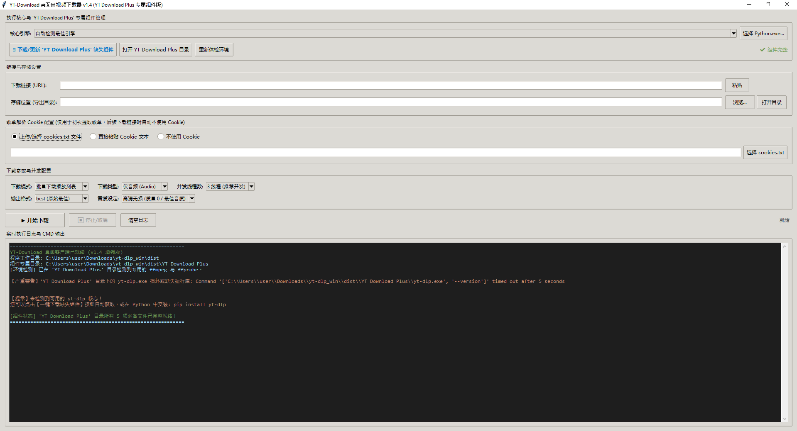

<div align="center">

# 🎵 YT-Download 桌面音视频下载器

**基于 yt-dlp 与 FFmpeg 的轻量级、多线程 YouTube / YouTube Music 桌面下载与转码工具**

[](https://www.python.org/)
[](https://github.com/)
[](LICENSE)
[](https://github.com/)

<p align="center">
  <b>单文件绿色免配置</b> • <b>YT Download Plus 专属组件自愈</b> • <b>脱敏 Cookie 直连下载</b> • <b>多线程高速并发</b>
</p>

<!-- 软件界面预览图，请将图片放置在 docs/images/ 路径下或替换为图床直链 -->


</div>

---

## 📖 软件简介

**YT-Download** 是一款专为桌面用户打造的现代化音视频下载利器。针对传统命令行工具配置复杂、易报缺失 DLL、批量下载缓慢卡顿等痛点，本项目进行了全方位的架构革新：

* **单文件极致便携**：打包后仅生成 **1 个独立的 `.exe`** 文件，双击即可直接运行，无需用户配置任何 Python 环境。
* **组件智能按需自愈**：软件在运行目录下自动建立 `YT Download Plus` 专属目录，仅在检测到缺少 `ffmpeg.exe` 或 `yt-dlp.exe` 时自动从 GitHub 镜像高速下载补全，已存在时**绝不重复下载**。
* **脱敏 Cookie 直连下载**：仅在解析私享/受限歌单时使用 Cookie；一旦生成播放列表文本，下载阶段**完全剥离 Cookie**，直接多线程访问公开链接，彻底避免账号风控。
* **多线程并发引擎**：内置 1~8 线程可调节并发下载池，告别单曲串行等待，大幅提升批量下载效率。
* **界面丝滑不卡死**：全异步多进程管道流调度，实时在只读日志框高亮反馈下载百分比、下载速度与 CMD 输出。

---

## 🌟 核心特性一览

| 模块 | 功能说明 |
| :--- | :--- |
| **执行核心** | 支持 `YT Download Plus` 独立版核心，支持自动扫描并无缝切换本地多个 Python 环境（解决 `python310.dll` 缺失）。 |
| **存储管理** | 支持下载前自由指定输出目录，一键调用系统资源管理器直达下载文件夹。 |
| **认证管理** | 支持“不使用 Cookie”、“直接粘贴 Cookie 文本（自动修复空格制表符）”与“加载 cookies.txt 文件”。 |
| **批量歌单 (Mode A)** | 自动提取歌单标题并去除特殊字符创建专属目录，生成链接列表文本，脱敏多线程批量下载。 |
| **单支媒体 (Mode B)** | 自动归档至 `Single_Downloads` 专属文件夹，极速转码完成。 |
| **格式与品质** | 音频格式（`mp3`, `wav`, `m4a`, `best`）、视频格式（`mp4`, `mkv`, `best`），默认无损音质（质量 0）。 |
| **多线程支持** | 支持自定义 1~8 线程并发，每个任务具备独立状态追踪，支持一键优雅中止。 |

---

## 🚀 快速上手使用

### 1. 终端用户（直接运行 EXE）
1. 前往本仓库的 [Releases 最新发布页面](../../releases/latest) 下载 `YT-Download.exe`。
2. 将 `YT-Download.exe` 放置在任意您喜欢的文件夹中（例如桌面或下载目录）。
3. 双击运行 `YT-Download.exe`：
   * 软件会自动在同级创建 `YT Download Plus` 文件夹。
   * 首次启动若缺少组件，点击界面上的 **【下载/更新 'YT Download Plus' 缺失组件】** 按钮即可全自动下载配置好 FFmpeg 与 yt-dlp！
4. 粘贴想要下载的歌单或视频链接，选择格式后点击 **【▶ 开始下载】** 即可。

### 2. 开发者（源码运行与二次开发）
```bash
# 1. 克隆本仓库代码
git clone https://github.com/YOUR_USERNAME/YT-Download.git
cd YT-Download

# 2. 安装 Python 依赖
pip install -r requirements.txt

# 3. 直接以源码启动客户端
python main.py

# 4. 运行全套自动化测试
python test_app.py
```

---

## 🛠️ 打包为单文件 `.exe` (PyInstaller)

在 Windows 环境下，直接双击运行工程根目录下的 `build.bat`，或者在终端中执行：

```cmd
pyinstaller --onefile --windowed --name="YT-Download" --clean main.py
```

打包完成后，生成的单文件便携可执行文件位于 `dist/YT-Download.exe`。

---

## ⚙️ 开发者配置：修改 GitHub 依赖下载直链

如果您自己部署了组件镜像，只需打开 `main.py`，在顶部 **第 32~55 行** 替换为您自己的 GitHub 直链：

```python
DEPENDENCY_DOWNLOAD_CONFIG = {
    "FOLDER_NAME": "YT Download Plus",
    "FILES": {
        "ffmpeg.exe": "https://github.com/YOUR_USERNAME/YOUR_REPO/releases/download/v1.0/ffmpeg.exe",
        "ffprobe.exe": "https://github.com/YOUR_USERNAME/YOUR_REPO/releases/download/v1.0/ffprobe.exe",
        "ffplay.exe": "https://github.com/YOUR_USERNAME/YOUR_REPO/releases/download/v1.0/ffplay.exe",
        "yt-dlp.exe": "https://github.com/YOUR_USERNAME/YOUR_REPO/releases/download/v1.0/yt-dlp.exe",
        "_internal.zip": "https://github.com/YOUR_USERNAME/YOUR_REPO/releases/download/v1.0/_internal.zip",
    }
}
```

---

## ❓ 常见问题排查 (FAQ)

<details>
<summary><b>Q1: 为什么提示 Failed to load Python DLL '_internal\python310.dll'？</b></summary>
这是由于使用了非独立的 yt-dlp 或本地打包文件缺少运行库。解决办法：在界面顶部的“核心引擎”下拉框中选择您系统中已安装 yt-dlp 的 Python 环境，或点击【下载/更新 'YT Download Plus' 缺失组件】获取官方独立单文件版。
</details>

<details>
<summary><b>Q2: 为什么提示“未能提取到任何有效链接”？</b></summary>
1. 检查 YouTube 歌单链接中的 <code>list=PL...</code> 是否完整，标准歌单 ID 长度通常为 34 个字符，请勿漏选后半段字符。<br>
2. 若该歌单为私享歌单，请在 Cookie 区域粘贴您已登录账号的有效 Netscape Cookie。
</details>

<details>
<summary><b>Q3: 下载速度较慢怎么办？</b></summary>
可以在界面中将“并发线程数”调高至 <b>3 线程</b> 或 <b>5 线程并发</b>，多任务同时进行下载。
</details>

---

## ⚠️ 免责声明 (Disclaimer)

本项目仅供个人学习、音频格式转码研究及技术交流使用。请尊重相关版权方的原创成果，不得将本项目用于商业牟利或侵犯他人合法权益之行为。使用者因滥用本软件产生的一切法律责任由使用者自行承担，与开发者无关。

---

## ☕ 赞助与支持 (Donate)

如果您觉得 **YT-Download** 帮助到了您，节省了您的宝贵时间，欢迎请作者喝一杯热咖啡或 local 冰奶茶！☕  
您的每一份支持都是持续更新与维护的最大动力，非常感谢！💖

<div align="center">

| 马来西亚 DuitNow QR |
| :---: |
|  |
| *支持各本地银行与各大 TNG / Boost / ShopeePay 钱包扫描* |
<br />

</div>

> 📌 **给作者留言**：欢迎在打赏留言中留下您的 GitHub ID 或宝贵建议，您的名字将收录在项目的鸣谢支持者列表中！

</div>
